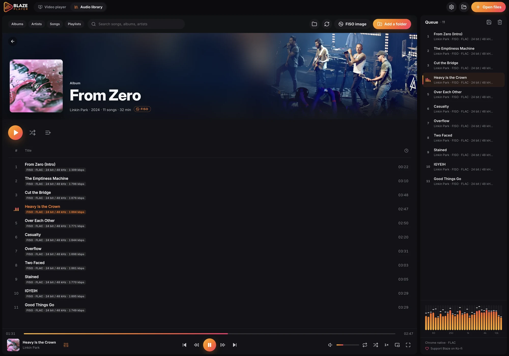

# FISO — Flac ISO

**FISO** is an open, royalty-free disc image format for audio CDs. One `.fiso` file holds a whole disc: the audio compressed with lossless **FLAC**, the exact disc structure (tracks, indexes, pre-gaps, hidden track one audio, ISRC, MCN, TOC), metadata including multi-disc albums, artwork, and SHA-256 integrity data.

**FISO Explorer** is the desktop application to create, open, play, verify and convert FISO images.

<p align="center"><a href="../../releases/latest"><b>Download FISO Explorer</b></a> · <a href="spec/FISO_FORMAT_v1.0.md">Read the specification</a> · <a href="#players-with-fiso-support">Players with FISO support</a> · <a href="docs/PRESENTATION_FR.md">Présentation en français</a></p>

## Why FISO?

* **Lossless and exact.** Decoding a FISO image gives back the original audio bit for bit, with the original track boundaries, pre-gaps and indexes — not just a folder of tracks.
* **One disc, one file.** Audio, structure, metadata and covers travel together. A box set is a group of images sharing an album identifier.
* **Gap-less by design.** The disc timeline is stored continuously, so playback and track export never add or lose a single sample between tracks.
* **Verifiable.** Three separate integrity states: *valid file* (structure), *intact audio* (decoded audio matches the stored checksums), *verified rip* (matched against an external reference such as AccurateRip).
* **Open.** The specification is public domain (CC0) and the reference code is Apache-2.0: any program may read and write FISO files.

## Download

Installers are attached to each [release](../../releases/latest):

| System | File | Notes |
|---|---|---|
| macOS 12 or later, Apple Silicon (M1 and later) | `FISO-Explorer-<version>-mac-arm64.dmg` | |
| macOS 12 or later, Intel | `FISO-Explorer-<version>-mac-x64.dmg` | |
| Windows 10/11, 64-bit | `FISO-Explorer-<version>-win-x64.exe` | installer |
| Linux, 64-bit (x86_64) | `FISO-Explorer-<version>-linux-x86_64.AppImage` | no installation needed |

The source code of each version is available on the same page (*Source code* zip or tar.gz).

### Installing

**macOS** — Open the `.dmg` and drag *FISO Explorer* to *Applications*. The app is not notarized by Apple, so the first launch is blocked: open *System Settings › Privacy & Security*, scroll down and click **Open Anyway** next to the message about FISO Explorer, then confirm. This is needed only once.

**Windows** — Run the installer. If Microsoft Defender SmartScreen shows *Windows protected your PC*, click **More info**, then **Run anyway** (the installer is not code-signed).

**Linux** — Make the AppImage executable and run it:

```sh
chmod +x FISO-Explorer-*-linux-x86_64.AppImage
./FISO-Explorer-*-linux-x86_64.AppImage
```

On Ubuntu 22.04 and later, AppImages need FUSE 2: `sudo apt install libfuse2` (Ubuntu 24.04: `sudo apt install libfuse2t64`).

## Features

| Feature | macOS | Windows | Linux |
|---|:-:|:-:|:-:|
| Create images from FLAC/WAV files or BIN/CUE (FLAC files are stored without re-encoding when possible, or re-encoded on request with the same settings for every track) | ✓ | ✓ | ✓ |
| Rip audio CDs: secure mode, C2 error pointers, read offset, pre-gaps, hidden track, ISRC, MCN, CD-Text | ✓ | ✓ | ✓ |
| AccurateRip verification | ✓ | ✓ | ✓ |
| MusicBrainz metadata and Cover Art Archive artwork | ✓ | ✓ | ✓ |
| Gap-less playback, integrity check, metadata editing (audio is never touched) | ✓ | ✓ | ✓ |
| Export FLAC or WAV tracks, artwork, metadata (JSON) | ✓ | ✓ | ✓ |
| Convert to a burnable audio CD image (BIN/CUE for any burning software) | ✓ | ✓ | ✓ |
| Front cover shown as the file icon | ✓ (Finder) | — | optional thumbnailer |
| Interface languages: English, French, Spanish, German, Portuguese, Italian, Dutch, Japanese | ✓ | ✓ | ✓ |

On Linux, reading a CD requires your user to be a member of the group that owns the drive, usually `cdrom` (Debian, Ubuntu) or `optical` (Arch, Fedora): run `sudo usermod -aG cdrom $USER`, then log out and back in. On Windows, no administrator rights are needed.

FISO images are archives: they keep the audio exactly as created, including high-resolution audio. To burn a CD, use **Convert to a burnable audio CD image**, then open the `.cue` file with your usual burning software and burn in Disc-at-Once (DAO) mode.

## Players with FISO support

[**Blaze Player for Browser**](https://chromewebstore.google.com/detail/blaze-player-for-browser/lcceeboanbnanhcpmfjgidceiiaknlmk) is the first media player with native FISO support. It opens `.fiso` images directly in the browser and shows them as albums, with the cover, the track list and the audio format of each track.

<p align="center"><a href="https://chromewebstore.google.com/detail/blaze-player-for-browser/lcceeboanbnanhcpmfjgidceiiaknlmk"></a></p>

<p align="center"><a href="https://chromewebstore.google.com/detail/blaze-player-for-browser/lcceeboanbnanhcpmfjgidceiiaknlmk">Get Blaze Player for Browser on the Chrome Web Store</a></p>

Developers who want to add FISO support to another player can start from the [specification](spec/FISO_FORMAT_v1.0.md) and [docs/DEVELOPERS.md](docs/DEVELOPERS.md).

## Command-line tool

The `fiso` tool does everything the application does (the application is built on top of it):

```sh
fiso create "Album.fiso" --from-files *.flac --album "Album" --artist "Artist" --front cover.jpg
fiso create "Album - Disc 1.fiso" --from-cue album.cue --disc 1 --disc-total 2
fiso create "Album.fiso" --from-files *.flac --album "Album" --reencode   # same FLAC encoding for every track
fiso info   "Album.fiso"
fiso verify "Album.fiso"
fiso extract "Album.fiso" --format flac --out tracks/
fiso extract "Album.fiso" --format bin-cue --out cd/            # audio CD image for burning software
fiso meta set "Album.fiso" --title "3=New title" --genre Jazz
fiso group *.fiso                                               # multi-disc albums
fiso rip "Album.fiso" --offset 6                                # secure rip from the CD drive
fiso accuraterip "Album.fiso"
```

Run `fiso --help` for every command and option.

## Building from source

Requirements: CMake 3.20 or later, a C++20 compiler (Xcode 14+, GCC 11+ or Visual Studio 2022), Node.js 20 or later and git. libFLAC 1.4.3 is downloaded and linked statically during the first build.

```sh
# engine, command-line tool and tests
cmake -S . -B build -DCMAKE_BUILD_TYPE=Release
cmake --build build --config Release --parallel
cd build && ctest -C Release --output-on-failure

# application, in development mode
cd fiso-explorer && npm install && npm start
```

Installers: `./packaging/macos/build-mac.sh x64|arm64` (on a Mac), `packaging\windows\build-windows.ps1` (on Windows), `./packaging/linux/build-linux.sh` (on Linux). Details in [docs/BUILDING.md](docs/BUILDING.md); the C API is described in [docs/DEVELOPERS.md](docs/DEVELOPERS.md).

## Repository layout

| Folder | Contents |
|---|---|
| [`spec/`](spec/) | FISO v1.0 specification ([English](spec/FISO_FORMAT_v1.0.md), [French](spec/FISO_FORMAT_v1.0_FR.md)) and JSON schema of the metadata |
| [`libfiso/`](libfiso/) | Reference library (C++20) with a stable C API: [`fiso.h`](libfiso/include/fiso/fiso.h) |
| [`fiso-cli/`](fiso-cli/) | The `fiso` command-line tool, built only on the public C API |
| [`fiso-explorer/`](fiso-explorer/) | The desktop application (Electron) and the macOS Quick Look extension |
| [`tests/`](tests/) | Conformance tests, including a simulated CD drive |
| [`test-files/`](test-files/) | Freely redistributable sample images (synthetic audio) |
| [`packaging/`](packaging/) | Build scripts for the installers |

## Project status

Version 1.2.0 is the current release. The format, the library and the application are covered by automated tests on macOS, Windows and Linux. CD ripping and the Finder icons have been tested with a simulated drive and are awaiting confirmation on real hardware; please [open an issue](../../issues) if something does not work with your drive.

## Contributing

Bug reports and pull requests are welcome — see [CONTRIBUTING.md](CONTRIBUTING.md).

## License

* Code: [Apache License 2.0](LICENSE).
* Specification and schema: [CC0 1.0](spec/LICENSE) — implement FISO in free or commercial software, without royalties.
* Third-party components: libFLAC (BSD-3-Clause, Xiph.Org Foundation), Electron (MIT), nlohmann/json (MIT).
* MusicBrainz data is CC0; artwork from the Cover Art Archive remains subject to its owners' rights. AccurateRip is a service of Illustrate; FISO Explorer only reads its public database and the check can be turned off in Settings.

© 2026 Anthony Gentil — [Retro-Spare](https://dev.retro-spare.fr)
